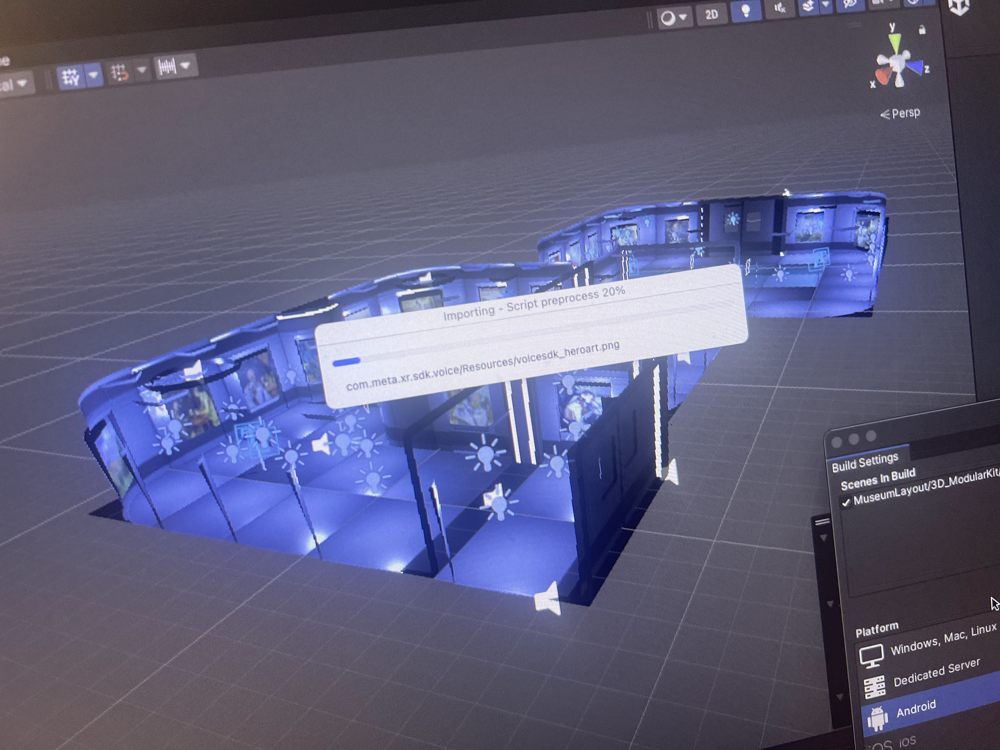

# VR Art Museum Simulator

*Note: Limited screenshots are available as the project was developed some time ago. While recreating the environment is possible, Due to current priorities, I’m unable to dedicate time to setting it up on the new machine.*

## Project Introduction
VR Art Museum Simulator is an application that provides an immersive experience using virtual reality (VR) technology to comfortably appreciate world-famous paintings and artworks. Users can view works by various artists and explore the gallery directly in a VR environment.

## Key Features
- **Immersive Gallery Experience**: Freedom to move around in a realistic 3D museum environment
- **Famous Artist Collections**: Masterpieces by world-renowned painters including Pablo Picasso, Claude Monet, Vincent van Gogh, Paul Cézanne, Katsushika Hokusai, and more
- **Teleport System**: Teleportation feature for free movement within the gallery
- **Audio Guide**: Background music system for artwork appreciation

## Technology Stack
- Unity 3D
- Oculus Integration SDK
- XR Interaction Toolkit
- Universal Render Pipeline (URP)
- C# Scripting

## Installation and Execution
1. Open the project in Unity Hub
2. Connect your Oculus/VR device
3. Run in the Unity editor or build and execute on your VR device

## Exhibited Works
The VR gallery features works by the following artists:

### Pablo Picasso
- Weeping Woman
- Les Demoiselles d'Avignon
- Le Rêve (The Dream)
- The Old Guitarist
- Portrait of Ambroise Vollard
- Bust of a Woman
- Two Girls Reading

### Claude Monet
Various impressionist works

### Vincent van Gogh

- The Carrot Puller
- Self-Portrait
- Avenue of Pollard Birches and Poplars

### Paul Cézanne
Major works

### Katsushika Hokusai
Japanese ukiyo-e artworks

## Movement Methods
- Teleporter devices allow quick movement between key areas within the gallery
- Natural movement is possible using VR controllers
- Move with WASD in Unity

## Development Environment
- Unity 2022.3 or higher
- Oculus Integration package
- XR Interaction Toolkit 2.4.0 or higher

## Future Plans
- Add more artists and artworks
- Expand interactive artwork information and audio guides
- Multiplayer gallery tour functionality
- User-customizable gallery configuration features

---

Experience the world's greatest artworks in an immersive VR art gallery! 🎨🖼️ 